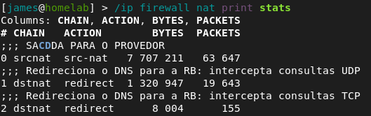
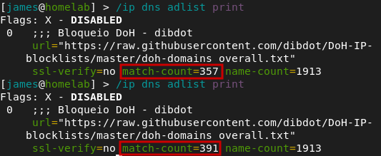
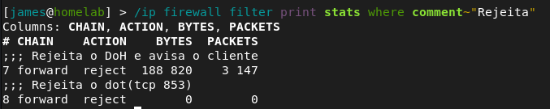
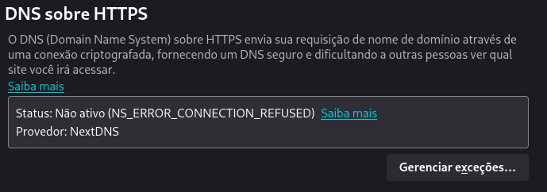

# MikroTik Defense-in-Depth: Bloqueio de DoH/DoT

> Arquitetura de **Defesa em Camadas** para impedir a evasão de DNS via DNS over HTTPS (DoH) e DNS over TLS (DoT) em redes MikroTik RouterOS v7.

---

## 📖 Sobre este projeto

Este laboratório nasceu de uma necessidade real: em ambientes com filtragem de conteúdo baseada apenas em DNS tradicional (porta 53), usuários podem facilmente burlar restrições ativando **DNS over HTTPS (DoH)** nos navegadores modernos (Chrome, Firefox, Edge).

Soluções endpoint como antivírus são válidas, mas limitam-se a dispositivos específicos e sistemas operacionais compatíveis. A abordagem de **controle no gateway de rede** garante proteção para **todos os dispositivos conectados**  incluindo celulares, TVs, IoT e visitantes.

Este projeto foi desenvolvido em uma **hAP ac²** (RBD52G-5HacD2HnD) rodando **RouterOS v7.23.2**, utilizando a documentação oficial do MikroTik como referência primária (via NotebookLM).

---

## 🏗️ Arquitetura de Defesa em Camadas

O projeto implementa **três camadas independentes** que se complementam. Se uma falhar, a outra pega.

### Camada 1 — Interceptar e Forçar DNS Local (Porta 53)

**Objetivo**: Garantir que qualquer consulta DNS na porta 53 seja redirecionada para o DNS interno do MikroTik, impedindo que dispositivos configurem DNS externos manualmente (placa de rede).

**Lógica:** Regras de `dstnat` no firewall interceptam pacotes destinados à porta 53 e redirecionam para a própria RB. Isso funciona tanto para IPv4 quanto para IPv6.

```routeros
/ip firewall nat
add action=redirect chain=dstnat comment="FORCAR-DNS IPv4: Intercepta UDP" dst-port=53 protocol=udp to-ports=53
add action=redirect chain=dstnat comment="FORCAR-DNS IPv4: Intercepta TCP" dst-port=53 protocol=tcp to-ports=53

/ipv6 firewall nat
add action=redirect chain=dstnat comment="FORCAR-DNS IPv6: Intercepta UDP" dst-port=53 protocol=udp to-ports=53
add action=redirect chain=dstnat comment="FORCAR-DNS IPv6: Intercepta TCP" dst-port=53 protocol=tcp to-ports=53
```

**Como atua:** `chain=dstnat` (antes do roteamento). O pacote nunca sai pela WAN.

---

### Camada 2 — Bloqueio de Domínios DoH via Adlist

**Objetivo:** Quando o navegador tenta resolver o nome de um servidor DoH (ex: `cloudflare-dns.com`), o MikroTik responde com `0.0.0.0` (IPv4) ou `::` (IPv6), impedindo que o navegador descubra o IP real do servidor.

**Lógica:** O RouterOS v7 possui o recurso nativo `adlist` que baixa automaticamente uma lista de domínios bloqueados a cada 4 horas e cria entradas DNS estáticas apontando para endereços nulos.

```routeros
/ip dns adlist
add url="https://raw.githubusercontent.com/dibdot/DoH-IP-blocklists/master/doh-domains_overall.txt" ssl-verify=no comment="Bloqueio DoH - dibdot"
```

**Verificação:**
```routeros
/ip dns adlist print
```

**Resultado esperado:** `name-count` em torno de **1900+ domínios** e `match-count` aumentando conforme os dispositivos tentam resolver nomes bloqueados.

---

### Camada 3 — Bloqueio de IPs Hardcoded via Firewall (Portas 443 e 853)

**Objetivo:** Navegadores trazem IPs de servidores DoH gravados de forma fixa no código-fonte (*hardcoded*). Esta camada rejeita conexões HTTPS (443) e DoT (853) diretas para esses IPs conhecidos.

**Lógica:** Uma `address-list` agrupa os IPs dos principais provedores DoH/DoT. Regras na `chain=forward` analisam pacotes que atravessam o roteador (origem LAN → destino Internet) e rejeitam conexões destinadas a esses IPs nas portas 443 e 853.

#### IPv4

```routeros
/ip firewall address-list
add address=1.1.1.1 list=DoH_IPs comment="DoH Cloudflare Primary"
add address=1.0.0.1 list=DoH_IPs comment="DoH Cloudflare Secondary"
add address=8.8.8.8 list=DoH_IPs comment="DoH Google Primary"
add address=8.8.4.4 list=DoH_IPs comment="DoH Google Secondary"
add address=9.9.9.9 list=DoH_IPs comment="DoH Quad9"
add address=94.140.14.14 list=DoH_IPs comment="DoH AdGuard Primary"
add address=94.140.15.15 list=DoH_IPs comment="DoH AdGuard Secondary"
add address=208.67.222.222 list=DoH_IPs comment="DoH OpenDNS Primary"
add address=208.67.220.220 list=DoH_IPs comment="DoH OpenDNS Secondary"
add address=45.90.28.0 list=DoH_IPs comment="DoH NextDNS"

/ip firewall filter
add action=reject chain=forward comment="Bloqueia DoH IPv4 (443) - avisa cliente" dst-address-list=DoH_IPs dst-port=443 protocol=tcp reject-with=tcp-reset
add action=reject chain=forward comment="Bloqueia DoT IPv4 (853) - avisa cliente" dst-address-list=DoH_IPs dst-port=853 protocol=tcp reject-with=tcp-reset
```

#### IPv6

```routeros
/ipv6 firewall address-list
add address=2606:4700:4700::1111 list=DoH_IPs_IPv6 comment="DoH Cloudflare Primary IPv6"
add address=2606:4700:4700::1001 list=DoH_IPs_IPv6 comment="DoH Cloudflare Secondary IPv6"
add address=2001:4860:4860::8888 list=DoH_IPs_IPv6 comment="DoH Google Primary IPv6"
add address=2001:4860:4860::8844 list=DoH_IPs_IPv6 comment="DoH Google Secondary IPv6"
add address=2620:fe::fe list=DoH_IPs_IPv6 comment="DoH Quad9 IPv6"
add address=2a10:50c0::ad1:ff list=DoH_IPs_IPv6 comment="DoH AdGuard Primary IPv6"
add address=2a10:50c0::ad2:ff list=DoH_IPs_IPv6 comment="DoH AdGuard Secondary IPv6"
add address=2620:119:35::35 list=DoH_IPs_IPv6 comment="DoH OpenDNS Primary IPv6"
add address=2620:119:53::53 list=DoH_IPs_IPv6 comment="DoH OpenDNS Secondary IPv6"
add address=2a07:a8c0:: list=DoH_IPs_IPv6 comment="DoH NextDNS IPv6"

/ipv6 firewall filter
add action=reject chain=forward comment="Bloqueia DoH IPv6 (443)" dst-address-list=DoH_IPs_IPv6 dst-port=443 protocol=tcp reject-with=tcp-reset
add action=reject chain=forward comment="Bloqueia DoT IPv6 (853)" dst-address-list=DoH_IPs_IPv6 dst-port=853 protocol=tcp reject-with=tcp-reset
```

> **Ordem das regras:** As regras de bloqueio DoH/DoT **devem estar antes** de qualquer regra `drop` na `chain=forward`. Se o `DROP GERAL` vier antes, as regras DoH nunca irão funcionar.

---

## ⚙️ Pré-requisitos e Limpeza

Antes de aplicar as camadas, verifique se não há configurações anteriores de DoH no MikroTik. Entradas antigas podem anular o bloqueio do adlist respondendo o IP real em vez de `0.0.0.0`.

```routeros
# Remove entradas estáticas que anulam o adlist
/ip dns static remove [find name="cloudflare-dns.com"]
/ip dns static remove [find name="dns.google"]
/ip dns static remove [find name="dns.quad9.net"]

# Desativa DoH nativo no MikroTik
/ip dns set doh-servers=""

# Verifica como está o DNS
/ip dns print
```

O campo `use-doh-server` deve estar **vazio**.

---

## 🧪 Testes

### Camada 1 (Redirect DNS)

No terminal, force uma consulta para um DNS externo:
```bash
nslookup google.com 8.8.8.8
```
O `nslookup` aponta para `8.8.8.8`, mas quem responde é o DNS do MikroTik (ex: `172.16.0.1`). O IP real do Google é retornado.

Consulte um domínio bloqueado pelo adlist apontando para um DNS externo:
```bash
nslookup cloudflare-dns.com 8.8.8.8
```
Se retornar `0.0.0.0`, o redirect funcionou — o Google jamais responderia com IP nulo.

shots/teste.png


**No MikroTik:**
```routeros
/ip firewall nat print stats
```
Contadores de `packets` e `bytes` devem aumentar.

[](shots/nat.png)


---

### Teste 2 — Camada 2 (Adlist / Bloqueio de Nomes)

No terminal do cliente:
```bash
nslookup cloudflare-dns.com
```

**Esperado:**
```
Nome:    cloudflare-dns.com
Endereço: 0.0.0.0
```

**Verificação no MikroTik:**
```routeros
/ip dns adlist print
```
A coluna `match-count` deve ter aumentado.

[](shots/adlist.png)


---

### Teste 3 — Camada 3 (Firewall / Bloqueio de IPs)

No navegador (Chrome/Edge/Firefox), ative o **DNS Seguro (DoH)** e selecione um provedor (Cloudflare, Google, etc.). Tente navegar em sites comuns.

**Esperado:**
- A navegação continua funcionando (fallback para DNS tradicional)
- No MikroTik, os contadores das regras de `reject` sobem:
```routeros
/ip firewall filter print stats where comment~"Rejeita"
```
[](shots/filter.png)

[](shots/firefox-reject.png)


**Comportamento do navegador:**
- **Modo automático / Padrão do SO:** Fallback rápido e transparente. O usuário nem percebe.
- **Modo manual (provedor fixo):** O navegador insiste no túnel DoH por mais tempo antes de desistir. Com `reject-with=tcp-reset`, o fallback é acelerado.


---

## ⚠️ Troubleshooting

### `adlist` mostra `name-count=0`

A URL pode estar inacessível ou o cache pode estar cheio.
- Verifique conectividade: `/tool fetch url="https://raw.githubusercontent.com/dibdot/DoH-IP-blocklists/master/doh-domains_overall.txt" keep-result=yes dst-path=teste.txt`
- Aumente o cache (exemplo): `/ip dns set cache-size=16384KiB`

### Regras DoH não acumulam contadores

Verifique a **ordem** das regras. Se houver um `DROP GERAL` antes das regras DoH, elas nunca serão avaliadas.
```routeros
/ip firewall filter print
```

### Navegação fica lenta com DoH ativado

Isso é esperado se o navegador está no modo manual (provedor fixo). O navegador insiste no túnel DoH antes de fazer fallback. A solução é usar `reject-with=tcp-reset` (já incluído nos comandos acima) ou configurar o navegador para **"Padrão do SO"**.

---

## 📦 Arquivos de Configuração (.rsc)

O repositório inclui scripts `.rsc` prontos para importação no MikroTik:

| Arquivo | Conteúdo |
|---------|----------|
| `configs/ipv4-doh-block.rsc` | Address-list e filter rules IPv4 |
| `configs/ipv6-doh-block.rsc` | Address-list, filter rules e NAT IPv6 |
| `configs/dns-config.rsc` | Configuração DNS + adlist |
| `configs/nat-dns-redirect.rsc` | Regras de redirect DNS porta 53 |

Para aplicar:
```routeros
/import ipv4-doh-block.rsc
```

---

## 📚 Referências e Créditos

- Documentação oficial do **MikroTik RouterOS v7** 
- Lista de domínios DoH: [dibdot/DoH-IP-blocklists](https://github.com/dibdot/DoH-IP-blocklists)
- Conceito de **Defense-in-Depth** aplicado a redes de pequeno porte

---

## 🏠 Ambiente de Laboratório

| Equipamento | Modelo | RouterOS |
|-------------|--------|----------|
| Roteador principal | MikroTik hAP ac² (RBD52G-5HacD2HnD) | v7.23.2 |

---

## 🔒 Nota de Segurança

> **Nunca publique backups completos (`/export`) do seu MikroTik em repositórios públicos.** Eles contêm senhas PPPoE, tokens de bots, chaves privadas de VPN, senhas WiFi e outros dados sensíveis. Este repositório contém apenas as regras específicas do projeto.

---

## 📄 Licença

Este projeto é livre para estudo e adaptação. Use por sua conta e risco.
